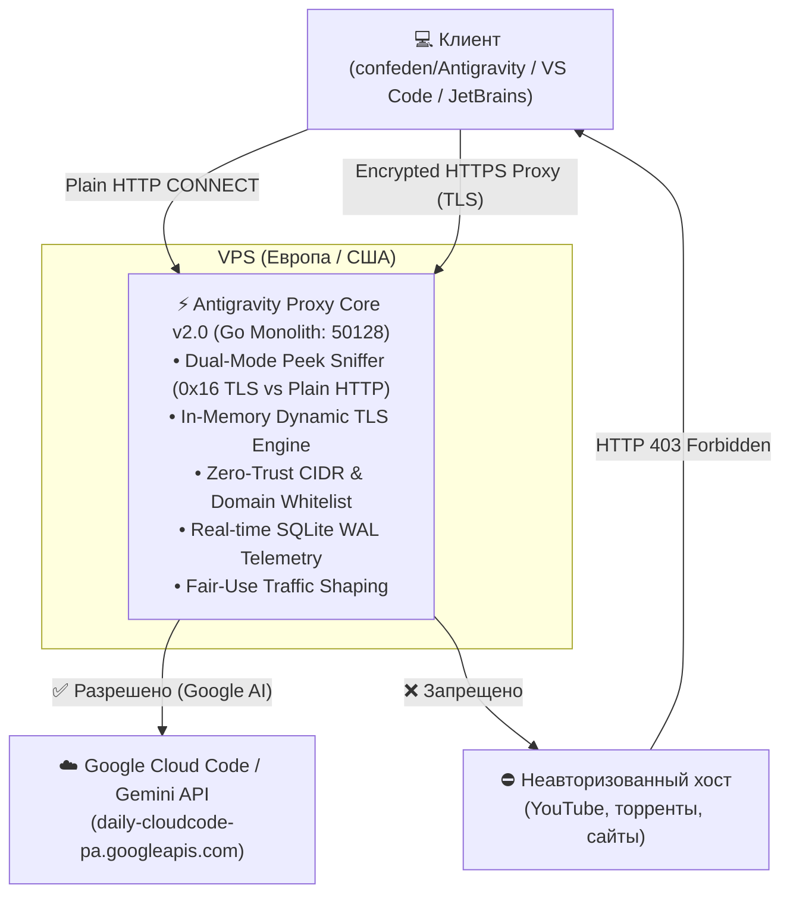

# 🚀 Antigravity Proxy Server (v2.0 Go Native Engine)

[](LICENSE)
[](https://go.dev/)
[]()
[](docker-compose.yml)
[](https://t.me/+8qU7020rMF84OWNi)

Высокоскоростной двухрежимный (Dual-Mode) монолитный шлюз-прокси на **Go** для обхода региональных ограничений и блокировок **Google Antigravity**, **Gemini Code Assist** и **Google Cloud Code**.

Разработан специально для интеграции с клиентом [confeden/Antigravity](https://github.com/confeden/Antigravity), а также расширениями для **VS Code** и **JetBrains IDE**.

💬 **Telegram-беседа сообщества:** [https://t.me/+8qU7020rMF84OWNi](https://t.me/+8qU7020rMF84OWNi)

---

## ⚡ Особенности и преимущества (v2.0 Go Engine)

| Особенность | Обычный VPN / Python Proxy | Antigravity Proxy v2.0 (Go) |
| :--- | :--- | :--- |
| **Архитектура** | HAProxy + SSL Terminator + Python | **Один статический бинарник (~6 МБ)** без внешних пакетов |
| **Зависимости** | Python, OpenSSL, HAProxy, bash-скрипты | **Без системных runtime-зависимостей** |
| **Режим входа** | Либо только HTTP, либо только HTTPS | **Двухрежимный (Dual-Mode):** авто-сниффинг через `Peek(1) == 0x16` (TLS vs Plain CONNECT) |
| **Туннелирование** | Копирование через userspace | **Zero-Copy Splice:** Linux-системный вызов `splice(2)` между сокетами в ядре |
| **TLS-сертификаты** | Генерация через OpenSSL на диск | **In-Memory TLS:** динамическая генерация ключей и сертификата в RAM |
| **Аудит и Real IP** | Костыли через PROXY protocol / 127.0.0.1 | **Честный прямой Real Client IP** из сокета без посредников |
| **Безопасность** | Трафик ходит куда угодно | **Zero-Trust Whitelist:** доступ только к API Google AI, остальное блокируется (403) |
| **Контроль трафика** | Аварийный обрыв канала при исчерпании | **Умный Fair-Use и мягкие лимиты:** 0ms задержки для AI-токенов |
| **Потребление ОЗУ** | 50+ МБ (Python + HAProxy) | **~10 МБ RAM** под нагрузкой с сотнями пользователей |

---

## 🏗 Архитектура



---

## 📊 Результаты нагрузочного тестирования (Benchmark: Go vs Python)

Стресс-тестирование на боевом сервере (50 параллельных клиентов, 300 запросов CONNECT с передачей данных к Google Cloud Code):

| Показатель | Python Proxy v1.1.1 | Go Proxy Core v2.0 | Преимущество Go |
| :--- | :--- | :--- | :--- |
| **Успешность (Success Rate)** | 100.0% (300/300) | **100.0% (300/300)** | Безупречная стабильность |
| **Средняя задержка (Avg Latency)** | 683.0 ms | **540.5 ms** | **На 21% быстрее** ⚡ |
| **Хвостовая задержка p95 (Tail Latency)** | 2075.5 ms | **1426.5 ms** | **На 31% меньше фризов** |
| **Хвостовая задержка p99** | 2829.9 ms | **2719.6 ms** | Стабильнее под пиками |
| **Потребление ОЗУ (Memory RSS)** | 38.6 MB (до 130 МБ) | **11.5 MB** | **В 3.3+ раза легче** |
| **Системные runtime-зависимости** | Python, pip, HAProxy, OpenSSL | **Нет** | 1 статический бинарник |

## 🚀 Быстрый старт (Установка на свой VPS за 1 минуту)

### Требования к серверу:
* Любой зарубежный VPS (рекомендуются дата-центры в Европе: Нидерланды, Германия, Италия, Финляндия).
* Операционная система: **Ubuntu 20.04 / 22.04 / 24.04** или **Debian 11 / 12**.
* 512 МБ RAM и 1 ядро CPU (хватит даже самого дешёвого тарифа за $1.5–$3/мес).

### Автоматическая установка (в одну команду):

Подключитесь к вашему VPS по SSH под пользователем `root` и выполните:

```bash
curl -sSL https://raw.githubusercontent.com/j46871417-ui/antigravity-proxy/main/install.sh | bash
```

Установщик собирает Go-бинарник, сохраняет текущие учётные данные и файл пользователей,
настраивает службу от отдельного системного пользователя и запускает Go-ядро на порту 50128.
Go 1.22+ нужен только во время сборки; HAProxy и Python для работы сервера не используются.

После установки создайте дополнительные учётные записи из командной строки:
```bash
sudo -u antigravity /opt/antigravity-proxy/antigravity-proxy users generate \
  --host proxy.example.com --count 3
```

По умолчанию CLI использует `users.json` рядом с бинарником (для установщика это
`/opt/antigravity-proxy/users.json`). Если служба настроена на другой путь `USERS_FILE`,
передайте его через `--file`. Сервер подхватывает изменения без перезапуска.
Команда выводит логин, пароль и готовый HTTPS URL; сохраните вывод безопасно,
поскольку пароль больше не показывается повторно.

---

## 🛠 Сборка из исходников

Требуется Go 1.22 или новее:

```bash
git clone https://github.com/j46871417-ui/antigravity-proxy.git
cd antigravity-proxy
go build -trimpath -ldflags="-s -w" -o antigravity-proxy .
PROXY_HOST=0.0.0.0 PROXY_PORT=50128 USERS_FILE=./users.json ./antigravity-proxy
```

Прокси слушает порт 50128 напрямую и поддерживает HTTP CONNECT и TLS-прокси.
Учётные записи можно создавать той же CLI-командой:

```bash
./antigravity-proxy users generate --host proxy.example.com --count 3
```

---

## 🐳 Развёртывание через Docker / Docker Compose

Если вы предпочитаете Docker, Compose сохраняет пользовательские учётные записи и статистику в каталоге `./data`:

```bash
git clone https://github.com/j46871417-ui/antigravity-proxy.git
cd antigravity-proxy
cp .env.example .env
# Укажите собственный пароль в .env
docker compose up -d --build
```

---

## 👤 Генерация учётных записей через CLI

Команда `users generate` создаёт криптографически случайные логины и пароли,
добавляет их в JSON-файл пользователей атомарной заменой и выводит готовые
адреса подключения. Размер партии — от 1 до 100 аккаунтов.

Для systemd-установки запускайте CLI от имени пользователя службы, чтобы файл
сохранил нужного владельца:

```bash
sudo -u antigravity /opt/antigravity-proxy/antigravity-proxy users generate \
  --host proxy.example.com --count 3
```

Укажите другой файл через `--file /path/to/users.json`. При запуске из Compose:

```bash
docker compose exec antigravity-proxy /app/antigravity-proxy users generate \
  --host proxy.example.com --count 3 --file /data/users.json
```

Считайте вывод команды секретным: он содержит пароли и строки подключения.

---

## 💻 Подключение в клиенте Antigravity

1. Скачайте свежий релиз программы: [confeden/Antigravity](https://github.com/confeden/Antigravity/releases).
2. Запустите `Antigravity.exe` (или `tui.exe` / `tui.sh`).
3. В интерактивном меню нажмите **`1. Свой прокси`** (Own proxy).
4. Вставьте строку подключения:
   ```text
   https://ваш_логин:ваш_пароль@IP_СЕРВЕРА:50128
   ```
5. Программа проверит шлюз Google Cloud Code и подтвердит статус:
   `✅ Свой прокси включён`.
6. Открывайте **VS Code** или **JetBrains** с установленным расширением **Google Cloud Code / Gemini Code Assist** и пользуйтесь нейросетью без ограничений!

---

## 🛡 Белый список хостов (Zero-Trust Whitelist)

Прокси пропускает запросы **только** к ресурсам, строго необходимым для работы Antigravity и разработческих AI-инструментов:
* `cloudcode-pa.googleapis.com` / `daily-cloudcode-pa.googleapis.com` (генерация кода Google Cloud Code)
* `generativelanguage.googleapis.com` (Gemini API)
* `accounts.google.com` / `oauth2.googleapis.com` (авторизация аккаунта Google)
* `gemini-api-docs-mcp.dev` (официальный MCP-сервер документации Gemini API для субагентов)
* `antigravity-cli-auto-updater-*.run.app` / `*.run.app` (авто-обновление компонентов Antigravity)
* `api.openai.com` / `*.openai.com` (API OpenAI для мульти-модельных конфигураций)
* `*.googleapis.com`, `*.googleusercontent.com`, `*.gstatic.com`, `*.google.com`
* `www.cloudflare.com` (проверка региона патчером через `/cdn-cgi/trace`)
* `chatgpt.com`, `claude.ai` (резервные проверки патчера)
* **Подсети Google AS15169**: поддержка клиентов в режиме TUN / Proxifier, где DNS резолвится локально в прямые IP-адреса Google на портах 80, 443 и 5228.

Попытки использовать этот прокси для общего веб-сёрфинга, торрентов, соцсетей или загрузки сторонних файлов мгновенно отклоняются сервером (`403 Forbidden`).

---

## ⚖️ Fair-Use и мягкое шейпирование трафика (Traffic Shaping)

Чтобы гарантировать стабильность работы для всех пользователей и защитить сервер от исчерпания месячной квоты хостинга (например, 3 ТБ/мес), в ядро прокси встроен многоуровневый интеллектуальный механизм контроля трафика:

* **⚡ 0 мс добавленной задержки для AI-токенов:**
  Потоковые ответы и генерация кода передаются небольшими чанками (< 32 КБ). Для них шейпинг полностью отключен — ответы приходят с абсолютной минимальной сетевой задержкой.
* **🌊 Сглаживание пиковых скачков (Burst Rate Smoothing):**
  При передаче непрерывных тяжелых пакетов (> 32 КБ) скорость плавно сглаживается до ~28-30 Мбит/с. Это предотвращает насыщение внешнего канала сервера отдельными клиентами.
* **🛡 Мягкий месячный лимит (Soft Limit — по умолчанию 30 ГБ/мес на аккаунт):**
  При превышении порога соединение **НЕ разрывается** и аккаунт **НЕ блокируется**. Скорость мягко снижается до ~3.5 Мбит/с (400 КБ/с). Этой скорости с многократным запасом хватает для комфортной работы AI-ассистента и подсказок в IDE, но она надёжно блокирует фоновую выкачку больших объемов данных.
* **📅 Автоматический помесячный учет:**
  Статистика хранится в локальном файле `user_traffic.json` с помесячной структурой (`YYYY-MM`) и автоматически сбрасывается 1-го числа каждого месяца.
* **🔧 Тонкая настройка через переменные окружения:**
  - `USER_MONTHLY_SOFT_LIMIT_BYTES` — лимит байт в месяц (по умолчанию `32212254720` = 30 ГБ).
  - `USER_TRAFFIC_FILE` — путь к файлу статистики трафика (по умолчанию `/opt/antigravity-proxy/user_traffic.json`).

---

## 💬 Сообщество и поддержка

Если у вас появились вопросы по настройке, предложения или вы хотите обсудить проект:
👉 **[Присоединиться к нашей Telegram-беседе](https://t.me/+8qU7020rMF84OWNi)**

---

## 📄 Лицензия

Проект распространяется под открытой лицензией [MIT](LICENSE).
Свободно для использования, модификации и распространения.
